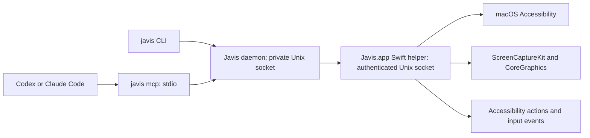

# Architecture

## Process ownership

The CLI starts the daemon on demand. It listens only at `~/Library/Application Support/Javis/daemon.sock`; the directory is restricted to the current user and the socket is mode `0600`. A lock prevents duplicate daemons. The daemon serializes requests, stops after five minutes without work, and uses a 60-second request deadline. It does not retry an action after an uncertain delivery.

When native work is first needed, the daemon creates a private directory for `helper.sock` and a random token. It launches the signed app through `/usr/bin/open -n -g -W ... --agent ... --controller-pid <daemon-pid>`. The helper validates the socket peer PID and UID against that controller and checks the request token. Helper startup has a ten-second connection deadline. It closes when its authenticated connection hangs up; daemon cleanup can also reap the exact helper process after verifying its full command and UID.

The helper's protocol version is `1`. A handshake exposes supported capabilities before later requests. The daemon rejects an incompatible version and discards that connection. Both sockets use line-delimited JSON; request IDs pair replies with calls. There is no TCP listener.

## Observations and sessions

The Swift provider selects an app by bundle ID, name, or `pid:N`, then an on-screen window by ID or index. It combines macOS Accessibility attributes and actions with a window screenshot. The result contains a tree of numbered elements, focused element, window metadata, optional PNG, screenshot status, and `coordinateSpace: "window"`. Screenshot pixels can be downscaled; action coordinates remain in original window points and must account for `screenshot.scale`.

The native helper retains short-lived element identity for actions (at most 32 snapshots, two minutes). The daemon also retains a per-session tree baseline for optional action-result diffs. CLI observations return a new `sessionId` unless one was supplied; every CLI action requires it. Each MCP server process generates its own session automatically. An index is valid only for a recent observation of that app and window; Javis rejects stale or changed targets rather than guessing.

## Actions and outcomes

Actions include click, named secondary action, set value, type, key, hotkey, paste, scroll, and drag. The helper prefers an advertised accessibility action or direct value write. It uses synthetic input or clipboard delivery when the semantic path cannot perform the operation. Background delivery keeps the frontmost app and pointer in place where supported. `restoreWindow` explicitly chooses foreground delivery.

The helper observes again after the action and reports `action.path`, `action.delivery`, and `action.verification`. Value mismatches become `verification_failed`; synthetic input remains unverified until a caller inspects state. If input was delivered but observation then fails, the result retains the action and adds `observationError`, `snapshot: null`, and `screenshot: null`. The agent must reobserve before deciding what happened. See the [protocol](protocol.md) for result shapes.

## Permission boundary

`Javis.app` owns the macOS Accessibility and Screen Recording grants. `javis permissions status` and `open` launch the signed app through LaunchServices so the status is attributed to the same identity used for native work. Normal observations never open System Settings. The helper refuses blocked password-manager apps and redacts secure element values. The CLI writes captured screenshots to mode `0600` temporary files; MCP sends an image content block instead of placing PNG base64 in text.
