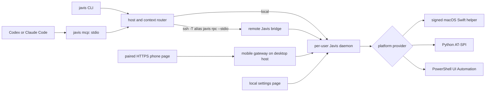

# Architecture

## Process ownership

The CLI starts the local daemon on demand. It serializes provider requests, owns sessions and tree baselines, and stops after idle time. The daemon endpoint is a user-private Unix socket on macOS/Linux or a token-authenticated per-user named pipe on Windows; neither is a network listener. A request deadline closes the current provider generation and reaps its child after timeout. A later request starts a fresh generation. No action is automatically replayed after uncertain delivery.

On macOS, the daemon creates a private helper socket directory and random token for each generation. It starts the signed `Javis.app` through LaunchServices, preserving the app's Accessibility and Screen Recording identity without foreground activation. The helper admits only its trusted signed controller PID, same UID, and one-time token. It closes on controller disconnect; cleanup can reap the exact helper process.

On Linux, a Python 3 script calls AT-SPI in the selected user's graphical login. PyGObject/AT-SPI are required. Optional GDK/Pixbuf, `xdotool`, and `wl-copy`/`xclip`/`xsel` affect screenshots, hotkeys, modified clicks, typing, and paste. X11 and Wayland differ; capability flags are computed from the active environment. Linux does not support target-by-window-ID in this provider, so use a window index.

On Windows, a PowerShell 5.1 script uses .NET UI Automation in the user's interactive desktop. A persistent `-Serve` child reduces startup cost; after host failures Javis can use one-shot operations and later try the persistent host again. PowerShell execution policy starts at `RemoteSigned`, with a narrowly scoped fallback when a policy block is detected. This architecture does not imply Windows GUI verification from macOS.

## Host routing and session identity

The router uses the local daemon unless the caller supplies `--host <OpenSSH alias>` or MCP `host`. A remote call starts `ssh -T <alias> javis rpc --stdio`, sends one newline-framed JSON request, and receives one response. The bridge allows declared computer methods and read-only permission status, then passes computer validation through the remote daemon. SSH handles authentication and host key checks. The remote host must have Javis installed and an active desktop login; a worktree value never changes the selected host.

`--session <ID>` names an explicit session. `--worktree <opaque ID>` instead names an isolated session context on that host; the name need not be a Git worktree. If neither is supplied, the CLI uses the canonical current directory as context, including plain folders. These modes are mutually exclusive. The daemon keys observation state by host-side context, app, and window. MCP keeps a session per connection, host, and worktree. An indexed action without a recent observation in its context fails rather than targeting a stale element.

The provider chooses an app by supported identifier, then a window by ID or index according to capabilities. A snapshot contains numbered tree elements, focused element, window metadata, screenshot status, and `coordinateSpace: "window"`. The image may be downscaled; divide image pixels by `screenshot.scale` before sending window-local action points. The daemon retains a short-lived tree baseline for default action diffs. CLI materializes screenshot bytes in a private temporary file on the caller; a remote file path is never treated as local.

## Actions and outcomes

The nine actions are click, perform secondary action, scroll, drag, type text, press key, hotkey, paste text, and set value. Providers prefer semantic accessibility actions and report the actual path, delivery, and verification state. Background delivery is attempted only where supported; `restoreWindow` is an explicit foreground request. A value mismatch is a verification failure. If input was delivered and the next observation fails, the result retains `action` and `observationError` with `snapshot: null` and `screenshot: null`. A timeout or SSH disconnect may also leave delivery uncertain. The caller must inspect the target before deciding whether another action is safe.

## Settings and mobile boundaries

The macOS settings page is served on loopback under an unguessable path. Its read view shows permissions; origin, token, and request checks protect setup, reset, and Agent installation mutations. Permission status, setup, and reset run through the per-user daemon so probes are paced and shared across CLI/MCP processes; reset invalidates the cached grant. Opening system setup is explicit. The signed app remains the owner of macOS grants.

The mobile gateway is separate from the daemon and listens on an explicitly selected IP. A non-loopback bind requires HTTPS certificate and key. A one-time pairing code expires after five minutes; a paired device receives an HttpOnly, SameSite=Strict cookie (Secure over HTTPS; omitted for loopback HTTP). Mutating calls require same-origin and CSRF checks. The gateway stores each device's target app, window, session, and latest screenshot geometry. It forwards only allowed calls to the local daemon, serves no remote socket, omits local screenshot paths, and requires a fresh observation after an ambiguous action result. It automates the desktop host, not the phone.
