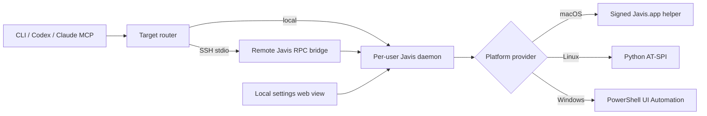

# Independent Javis CUA parity design

## Goal and source of truth

Javis remains a standalone Agent tool. It must build and run without an Orca checkout or runtime, while covering the computer-use operations that Orca exposes at commit `729f757b592244176420a86114c1ea23911eeeba`. The public tool names and result shapes remain Javis-owned. Orca source is a reference and retains its MIT license notice.

Orca exposes 13 computer operations plus capabilities and permission status/setup: app and window discovery, observation, click, secondary action, scroll, drag, type, press key, hotkey, paste, and set value. Linux uses Python 3 with AT-SPI and optional desktop utilities. Windows uses a PowerShell UI Automation provider. macOS uses a signed Swift helper. Orca selects the runtime host before calling the provider; its `--worktree`/`--session` identifies a snapshot context, not a separate desktop. Orca Mobile currently has no `computer.*` route or CUA screen.

## Architecture

The daemon remains the single owner of per-user sessions and serializes provider calls. A provider interface has `capabilities`, `listApps`, `listWindows`, `snapshot`, `action`, and `shutdown`. The macOS implementation owns a fresh helper socket directory and token per process generation. Linux and Windows provider adapters translate the existing Orca bridge protocol into Javis result types, without importing Orca packages. Windows may keep a PowerShell `-Serve` child for latency and fall back to one-shot calls after host failure. Every timeout closes the provider generation and reaps its child before a later request.

The router selects local Javis by default. `--host <SSH alias>` or an MCP host parameter explicitly selects a remote installation via `ssh -T <alias> javis rpc --stdio`. SSH verifies host identity; Javis never exposes the helper or daemon socket on TCP. A newline-framed bridge returns the same result/error envelope. Remote actions are never retried after timeout, disconnect, or indeterminate delivery. The caller materializes screenshot bytes into its own private temporary file; remote paths are never presented as local paths.

`--worktree <opaque ID>` and `--session <ID>` are mutually exclusive targeting modes. A worktree/folder context is a session namespace on the selected host and never silently changes host. When omitted, the CLI uses the canonical current directory as a context, including non-Git folders. Explicit session IDs remain supported. The daemon refuses an indexed action without a fresh observation in that context, even if Orca's original CLI would allow a stale index.

## Security and permissions

The macOS helper accepts only its controller PID, UID, token, and trusted signed controller identity. It rejects a self-launched helper even if the same user supplies their own token. Linux and Windows desktop providers run as the Javis user in the active graphical login and inherit the OS automation permissions. The daemon endpoint is user-private: Unix socket mode `0600` on macOS/Linux and a per-user named pipe with owner checks on Windows. SSH transport delegates authentication and host key checking to OpenSSH. The remote stdio bridge allows only declared computer methods and passes requests through the local daemon's normal validation.

A macOS settings surface shows both permission states, refresh, open setup per permission, reset grants, and Codex/Claude skill installation state. The underlying CLI exposes the same operations. Status probes are paced, coalesced and cancelled on reset; timed-out status helpers are reaped. Opening setup is an explicit user action. No ordinary observation opens System Settings or raises an app.

## Result and failure contract

The cross-platform provider capabilities truthfully gate unsupported methods. Trees, screenshots and semantic actions keep Orca's result schema. A delivered action with a later observation failure returns `action`, `observationError`, and null fresh snapshot, preserving Javis's stronger delivery contract. A timeout returns `action_timeout`; it never becomes a generic transport error. CLI and MCP default to action-result tree diffs and reject simultaneous window ID/index. If saving a screenshot to a temporary file fails, CLI retains inline image data and a recoverable warning. Permission, dependency and platform errors include a concrete next step without leaking tree, screenshot or input content.

## Verification

Tests cover routing, method allowlisting, host/context session isolation, helper generation rotation, timeout and reaping, capability gates, bridge rendering, permission reset/status races, and CLI/MCP parity. Run TypeScript and Swift tests on macOS; run Python unit tests for the Linux provider on macOS/Linux; run PowerShell/provider integration on Windows CI. Read-only GUI smoke checks require an existing authorized window. Mutable GUI checks run only in isolated graphical sessions. A clean copied repository must build without Orca or `@orca/*` imports.

## Mobile scope

Orca Mobile explicitly lacks CUA. The user chose to add a phone-browser CUA interface to Javis anyway. The separate design is in `2026-11-16-javis-mobile-cua-design.md`; its HTTPS gateway calls the Javis daemon and never exposes the private helper or daemon socket.
