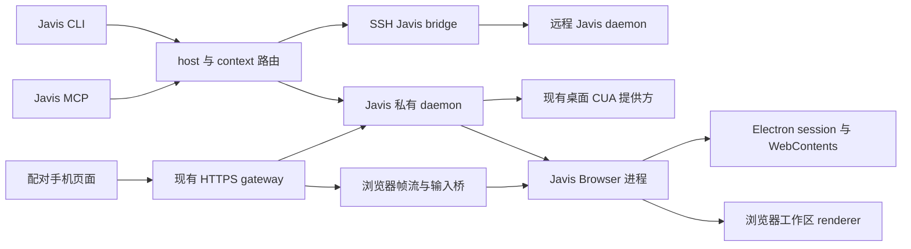

# Orca 内置浏览器迁入 Javis 的设计草案

状态：用户于 2026-11-19 批准完整设计与浏览器专用 Electron 例外；迁移实现和本地、独立副本验收已完成。完整三平台与高级流程一致性认证仍待相应平台实证，详见 [验证记录](../../browser-parity/verification.md)。安装现有应用和修改 Agent 用户配置不在本次授权范围内。

## 目标与基准

将 Orca 当前内置浏览器的实际实现迁入 Javis。交付范围包括浏览器界面、网页执行、自动化、配置与数据、扩展、远程与手机访问、打包与恢复。不能将仅支持打开网页、截图和点击的版本称为完整迁移。

- Orca 基准提交：`729f757b592244176420a86114c1ea23911eeeba`，版本 `1.4.214`。
- Javis 起始提交：`4de676041a74217228dc1c3c4aeda89aa394ca47`，版本 `0.2.0`。
- 浏览器 CLI 基准：`src/shared/orca-browser-cli-commands.ts` 中的 83 个命令。
- 浏览器 RPC 基准：`src/shared/rpc-contract/rpc-params-catalog.generated.ts` 中的 97 个 `browser.*` 方法。
- CLI、RPC、preload API 及源码清单记录在 [基准清单](../../browser-parity/orca-729f757-baseline.json)。清单记录当前版本，不会在验证时读取邻接 Orca 仓库重新生成期望值。
- 对齐以这次源代码快照为准。Orca 后续变化应作为独立同步请求处理。

“功能完全一样”指同一页面、配置、宿主条件和用户操作下，浏览器功能、参数、输出数据、页面事件、持久化和错误恢复与上述快照一致。Javis 使用自己的命令前缀、应用标识、数据目录和产品名称。Orca 的 IDE 外壳由 Javis 的 host/context 与浏览器工作区承接，不能用空实现吞掉浏览器所需的外壳事件。

## 当前状态和需要批准的架构调整

Javis 当前是 Node CLI/MCP + 私有 daemon + Swift/AT-SPI/UI Automation 平台提供方。设置页和手机页通过 HTTP 提供，不具有网页执行引擎、浏览器标签页或 Electron renderer。

Javis 的 `AGENTS.md` 明确要求：

> Do not reintroduce Electron, Orca RPC, or `@orca/*` imports.

Orca 的完整浏览器实现直接依赖 Electron `WebContents`、`<webview>`、session、Chromium 调试器、下载、扩展及原生事件。因此本方案需要用户批准一个明确例外：**允许新增独立的 Electron 浏览器进程；Javis 继续独立构建和运行，所有运行时通信采用 Javis 自有协议，不依赖 Orca RPC 服务或 `@orca/*` 包。**

既有 Swift CUA helper、隐私授权身份和后台输入规则保留。Electron 不承担其他桌面应用的 CUA 权限，不替换现有 CLI/MCP、平台提供方或签名控制器。

## 方案比较

| 方案 | 一致性 | 对 Javis 的影响 |
| --- | --- | --- |
| **独立 Electron 浏览器进程，迁入 Orca 实现（推荐）** | 可以复用相同 Chromium/Electron 能力、preload、扩展管理和浏览器界面 | 增加浏览器运行时、renderer 依赖及跨平台打包；需要批准 Electron 例外 |
| 改为浏览器优先的完整 Electron Javis 应用 | 同样可迁入，但 CUA 与应用生命周期也需大幅调整 | 扩大改动范围，影响现有签名与启动体系 |
| 保持无 Electron，另用 WebKit 或外部 Chromium重新实现 | WebKit 与 Chromium 扩展/session 行为不等价；外部 Chromium 仍需重写嵌入、扩展和界面桥接 | 不能直接复用 Orca 的实现，不满足本次迁移方式与完整一致性要求 |

选择推荐方案后，所有下述功能都属于交付目标。按阶段实现只是依赖顺序，不代表缩减最终范围。

## 进程与调用结构



### 浏览器生命周期

`src/browser/runtime/browser-process.ts` 负责按需启动、进程身份、私有 IPC、请求关联、退出与恢复。`src/browser/main/main.ts` 是 Electron 浏览器入口，与 Node daemon 分离。启动和健康查询不激活用户窗口；明确的 `javis browser open` 才展示浏览器工作区。

浏览器后台执行和无桌面自动化采用 Orca 对应的 offscreen backend。不能只创建一个隐藏窗口并假定所有 guest 已被挂载。浏览器页有稳定 page ID、实际 WebContents 归属、上下文、profile、渲染宿主和网络执行宿主。

页面恢复复用 Orca 的注册、首次绘制、owner lease、崩溃恢复和延迟挂载规则。daemon 停止需关闭自己拥有的浏览器连接和进程；调用方断开后不能重发已可能执行的动作。浏览器 UI 关闭、后台页面生存和 daemon 退出分别遵循迁入的生命周期契约。

无桌面服务端模式还需要迁入 `src/main/orcad/` 的浏览器 provider 选择、Electron serve process 和 external Chromium fallback 语义。不能把所有远程页面都硬绑定到在线桌面：服务端页面必须按源实现报告独立运行能力，客户端托管页面在客户端离线时则报告对应不可用错误。

### Javis 集成边界

- `src/runtime/daemon-dispatch.ts` 增加浏览器分派，不将浏览器命令送到当前桌面 CUA 的参数校验器。
- `src/runtime/public.ts` 的方法类型、请求校验、超时、关闭路径扩展到浏览器。方法参数和结果来自迁入的独立 browser contract。
- `src/runtime/target-router.ts` 继续统一 host/context 选择；context 既能指 Git 工作区，也能指普通目录或不透明会话 ID。
- `src/runtime/remote-stdio.ts` 保留现有一次请求协议，加入浏览器方法 allowlist。帧流、持续事件和文件分块使用单独、有生命周期和认证的流协议，不塞入一次 JSONL 响应。
- 浏览器源码引用的 `@orca/process-host` 相关进程逻辑迁入 Javis 自有命名模块，保留 Windows 隐藏窗口、参数转义和进程清理语义。
- renderer 引用 Orca store、runtime、workspace frame、IPC 的位置，通过 Javis 浏览器工作区 adapter 对接真实状态和事件。host/context 与 page/profile 的归属不能依赖 Git。

## 功能一致性清单

| 功能组 | Orca 实现入口 | Javis 交付与验收 |
| --- | --- | --- |
| 浏览器界面与工作区 | `src/renderer/src/components/browser-pane/`、browser store 与 navigation | 标签页、地址栏、导航、搜索、新标签页、加载和错误状态、分栏、浮动/弹窗、缩放、快捷键、历史、页面菜单等迁入；设置控件与浏览器页状态同步 |
| 网页引擎与生命周期 | `src/main/browser/guest-lifecycle/`、`backends/`、`src/preload/browser-guest.ts` | 相同 Electron guest/session 行为、注册归属、弹窗、页面对话框、first paint、guest 崩溃恢复、延迟挂载和页面关闭事件 |
| 自动化与 CDP | `agent-browser/`、`cdp/`、`src/main/runtime/browser/commands/` | 快照与 refs、delta、截图与全页截图、标注截图、PDF、元素动作、真实按键、坐标鼠标、滚动、选择、上传、页面等待、JS 执行；`expectUrl` 拒绝错误页面和后续步骤中的 URL 变化 |
| 动作结果 | agent-browser observation 与 action-effects | URL/title、页面差异、弹窗/新标签页、下载、console errors、loading/settled 等与 Orca 对齐；失败和未知执行状态不能伪装成功 |
| 配置与身份 | `sessions/`、`identity/`、settings/browser/profiles | 独立 profile、default/managed scope、列表/创建/删除/选择/克隆、UA 与 client hints、homepage/search/default zoom 等实际设置 |
| Cookie 与存储 | `cookies/`、runtime browser storage | Cookie 获取/设置/删除、导入已安装浏览器的 profile、清理指定 Google/default cookies、local/session storage 与 clipboard；导入使用用户明确选择的来源，不自动复制个人数据 |
| 密码与认证 | `src/main/browser-passwords/`、browser password preload、`webauthn/` | 原有密码 vault、保存/选择/填充、导入导出、平台解密与重新验证流程；WebAuthn 和相关账户请求按原有能力支持，受系统限制时返回真实状态 |
| 扩展 | `extensions/`、browser extension preload、settings/browser | 已解压目录与 Web Store 安装、启用/禁用/删除/重载、options、toolbar、content script/worker/storage/native messaging、权限提示和更新审阅；不超出 Orca 已实现的 Chrome 扩展 API 范围 |
| 站点设置与信任 | `site-settings/`、`certificate-trust/` | profile/origin 范围的权限、站点颜色/缩放、证书失败与显式信任流程、外部应用请求、网页对话框；保留原有安全界面 |
| 下载与文件交互 | `downloads/`、runtime download transfer、CDP file chooser | 下载目录/进度/取消/完成、浏览器文件选择、跨 frame 上传、remote/client 文件传输；远程文件路径不能直接作为本地路径返回 |
| 检查与网络控制 | capture/network commands、`network/`、devtools dock | console/network capture、request interception、headers/offline/HTTP credentials/media/geolocation/device/viewport、DevTools 与网络执行宿主路由 |
| 页面抓取、注释与文档 | `element-grab/`、annotate、workspace-doc、document-preview | 元素抓取、hover payload、区域截图、注释、未发送注释读取、页面与工作区文档预览；源实现中的依赖接入 Javis 文件/context adapter |
| 远程与配对桌面 | `client-hosts/`、`client-pages/`、runtime browser-host 与 routing | 明确区分客户端渲染、服务端页面、网络执行位置；离线错误、owner lease、恢复、页元数据、Cookie 和文件桥接与原行为对齐 |
| 手机浏览器访问 | runtime browser screencast、renderer remote stream/mobile driver | 手机查看/驱动内置网页、触摸输入、geometry、帧确认、订阅注销和重连，复用 Javis 配对与 CSRF；保留既有手机桌面 CUA 入口 |
| 浏览器高级入口 | browser dictation、desktop-browser-bridge 与相关 preload | 对源码中实际存在的语音输入、浏览器桥接等入口进行迁移；外部提供方暂时不可用时返回原有不可用结果，不静默吞掉调用 |

清单中的行为以源码实际存在的能力为准，例如 Chrome API 权限名出现不等于浏览器已经实现该项独立产品功能。每组均需补足其依赖闭包；基准清单只是发现范围，不允许把清单之外被导入的必需模块遗漏。

## 公共接口

### CLI

新增 `javis browser <Orca 浏览器命令>`，保留同样的 command words、参数名、page/profile 选择和结果数据。例如：

```text
javis browser tab create --url https://example.com --json
javis browser snapshot --page PAGE --interactive --json
javis browser click --page PAGE --element @e3 --expect-url https://example.com/ --json
javis browser screenshot --page PAGE --annotate --json
javis browser tab profile create --name NAME --json
javis browser extension list --json
```

使用 browser namespace 避免和既有 `javis computer click`、flat `javis click` 混淆。83 个原命令全部有映射；`browser identity get/set` 的原前缀在 namespace 中保留为 `javis browser identity get/set`，避免重复 `browser browser`。另外增加 `javis browser open` 作为 Javis 浏览器工作区的展示入口，增加 `javis browser status` 作为自身运行时状态查询入口。

现有 `--host`、`--session`/`--worktree` 和当前目录 context 规则延用。browser action 的 page ID 与浏览器 ref 独立于桌面 CUA element index。错误码和 browser result payload 保留源语义，外层沿用 Javis `{ ok, result }` / `{ ok, error }` 信封。

### RPC、MCP 和 Agent Skill

97 个原 `browser.*` 方法均记录并逐项映射。面向 Agent 的浏览器命令对应到 Javis browser tools，参数与 CLI 一致。`browser.clientHost.*`、持续帧确认等 host/control 方法由认证内部通道拥有，不能作为任意 Agent 操作暴露，也不能简单删除。

MCP screenshot 返回图片内容及结构化元数据；CLI 在调用方写出截图文件，延用 Javis 私有文件规则。MCP 与 CLI 共用参数校验和动作分派，不建立另一套简化实现。Agent Skill 补充 browser namespace、page pinning、refs、effects、expectUrl 与不确定动作恢复说明。

此次“内置浏览器迁移”不自动承诺第三方 `cua_repl` 能发现 Javis 标签页。交付接口是 Javis CLI、MCP、RPC 与自有页面/CDP桥；注册到外部 CUA 浏览器 host 属于该 host 的接入协议，不能仅因存在 CDP 就宣称已接通。

## 数据、配置与包依赖

浏览器状态写入 Javis 自己的数据根下：`browser/profiles/`、`browser/workspaces/`、`browser/extensions/` 和浏览器 vault。settings、site permissions、下载元数据、历史和页面归属按原 schema 分域。不同宿主与 profile 的状态隔离，删除/克隆事务沿用原实现。

首次启动创建空的 Javis 浏览器状态。迁移实现代码不意味着导入用户的 Orca profile、Cookie、密码或扩展；数据导入只通过迁入的显式 UI/CLI流程执行。

浏览器引擎初始固定为源版本 `electron@43.8.6`，agent-browser 对齐 `~0.39.4`，React/ReactDOM 对齐 `~19.2.8`，Playwright CDP 验证工具对齐 `1.64.1`。需要的依赖根据实际依赖闭包迁入 Javis lockfile。既有 Node CLI 的 Node 22+ 兼容要求保留，Electron 使用其自己的运行时。

运行时、构建及已安装应用不得读 sibling Orca checkout，不得 import `@orca/*` 或连接 Orca 服务。迁入的代码保留 MIT attribution 和必要第三方 license。UI 所需 primitives、i18n、字体、图标和 CSS 与浏览器实现一起迁入 Javis。

macOS 分发保留现有 `com.royran.javis` Swift app/helper 身份，浏览器作为独立签名的 `com.royran.javis.browser` 应用随 Javis 包分发。Electron helper、framework 和 browser app 从内到外签名，再验证外层 Javis 包；不能通过重写主执行文件改变原有 CUA 授权身份。Linux/Windows 安装包包含自己的浏览器运行时及资源。此次实施范围包含构建与打包，不自动修改用户已安装应用或 Agent 用户配置。

## UI 一致性

迁入浏览器页、toolbar、settings/browser 和必要 shadcn primitives，而不是重新画一套近似界面。颜色、字号、间距、阴影、主题、滚动条和 shortcut chips 使用 Orca `docs/STYLEGUIDE.md` 与 `src/renderer/src/assets/main.css` 中的原有设计规则。

Javis 自己的桌面浏览器工作区承载分栏、浮动浏览器及文档视图。对应 Orca 工作区操作在 Javis context 中有真实的页面和布局状态。浏览器 page UI 在给定相同 viewport、theme、语言、profile 与 fixture 页面时应得到一致的布局和交互，应用名称/标识使用 Javis。

## 依赖顺序与完成标准

1. **浏览器宿主与公共契约**：进程、独立构建、private IPC、page/profile/context、完整命令表与验证入口。产出可真正启动和执行网页的宿主。
2. **自动化和页生命周期**：迁入 agent-browser/CDP、截图/动作/refs/effects、guest 注册、弹窗、下载与恢复，接通 CLI/MCP/RPC。
3. **完整桌面浏览器界面**：迁入 browser-pane、工作区布局、导航、历史、DevTools、页面抓取/注释/文档及设置。
4. **Profile、站点、密码与扩展**：逐组迁入存储、导入、平台能力和 UI，完成权限与错误路径。
5. **远程/手机与浏览器网络路由**：移植 owner/placement/stream/file bridge，接通 Javis SSH、配对和 CSRF。
6. **独立分发与全量一致性验收**：macOS 签名打包、Linux/Windows 分发、依赖检查、行为对照与可复现渲染对照。

每阶段后能运行并验证其已交付部分；所有阶段完成且基准功能项都得到实证后，才称为“与 Orca 浏览器完整一致”。阶段性可用不能代替最终验收。实施计划在此设计获批准后按上述依赖写成具体文件和检查步骤。

## 验证

- Javis 起始基线：`npm run typecheck` 成功；`npm test` 为 43 个文件、282 项测试通过。基线不是迁移后的验收证据。
- 迁入每项关键行为时，优先复用源仓库已有、能捕获具体回归的测试。新增测试只能测试真正拥有该行为的层，期望值固定；不得测试复制文字、CSS class、第三方库实现或仅模拟调用次数。
- 完整检查包括 TypeScript、现有 CUA suite、browser unit/protocol suite、Swift tests、Linux provider tests、跨平台 build 和签名检查。
- 命令一致性按固定清单检查 83 个 CLI 映射；97 个 RPC 分为外部命令与内部 host/control 契约，分别验收。不能用返回 `unsupported` 的占位方法满足命令数量。
- 行为 fixture 覆盖跨 frame 输入/上传、弹窗与 dialog、stale ref、expectUrl 变化、viewport/device、download、profiles、Cookie/storage、扩展 content script 与更新、密码流程、崩溃和重启恢复。
- 远程 fixture 覆盖服务器页面与客户端托管页面、宿主断开、lease 恢复、帧背压和确认、文件分块、profile 与网络执行位置、手机断线后的重新观察。
- 渲染对照固定 viewport、主题、语言、平台和状态；源浏览器和迁入浏览器分别渲染同一 fixture，比较 browser surfaces。presentational components 可独立截图。
- Electron 检查通过 Playwright CDP 和隐藏 renderer 进行，启动使用 `ORCA_BACKGROUND_LAUNCH=1` 及 Javis 浏览器对应的后台启动策略；不调用窗口 show/focus，不对用户当前桌面执行点击/键盘测试。原生焦点和可见窗口测试只在隔离显示会话或 CI 上运行。
- macOS 本地验证不能视为 Linux/Windows GUI 验证。完整三平台一致性要求相应平台的验收证据。
- clean-copy build 与启动测试不得依赖 Orca checkout，使用复制出的 Javis 仓库和依赖检查完成。Orca 工作树在抽取、比较和交付后均保持不变。

## 当前审阅决策

本草案需要确认的具体决策是：批准推荐的独立 Electron 浏览器进程方案，并允许对 Javis `AGENTS.md` 的禁用 Electron 条款作浏览器专用例外。其他独立构建、Javis 自有协议、禁止 `@orca/*` 依赖、签名、后台观察、隔离桌面测试和不重放动作的约束继续有效。
